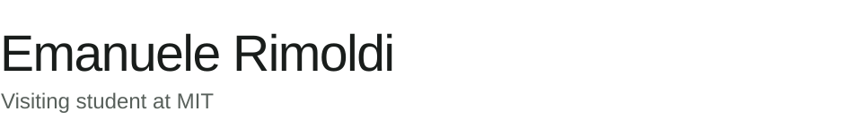

<a href="https://www.emanuelerimoldi.com/" title="Explore my website">
  <picture>
    <source media="(max-width: 600px) and (prefers-color-scheme: dark)" srcset="assets/profile/intro-mobile-dark.svg">
    <source media="(max-width: 600px)" srcset="assets/profile/intro-mobile-light.svg">
    <source media="(prefers-color-scheme: dark)" srcset="assets/profile/intro-dark.svg">
    
  </picture>
</a>

I’m a researcher at [MIT](https://www.mit.edu/ "Massachusetts Institute of Technology") working on [multi-agent systems for scientific discovery](https://openreview.net/forum?id=iAfYyiCzev "Agent Systems for Academic Research Automation") and [knowledge distillation through reinforcement learning](https://www.emanuelerimoldi.com/#research "Research and publications"). I also study how to [evaluate and verify agentic systems](https://arxiv.org/abs/2605.10851 "Generalizing the Turing Test to Interactive Agents") when tasks are open-ended, including settings without an external verifier.

<samp>background +</samp>

Before MIT, I worked on foundation-model pre-training and post-training in **Logitech’s CTO Office** with [Jonathan Dan](https://scholar.google.com/citations?user=0uHd7XIAAAAJ), and on bio-inspired text-to-speech and spiking neural networks at **Idiap Research Institute** with [Philip N. Garner](https://scholar.google.com/citations?user=c9nAX2AAAAAJ).

I studied Applied Physics at [Politecnico di Milano](https://www.polimi.it/en/), then Nuclear Engineering at [ETH Zurich](https://ethz.ch/en.html), [EPFL](https://www.epfl.ch/en/), and [PSI](https://www.psi.ch/en), before moving into Data Science at [EPFL](https://www.epfl.ch/en/).

I’m always open to collaboration and exchanging ideas. Stay in touch.

  <a href="https://www.emanuelerimoldi.com/"><samp>website&nbsp;↗</samp></a> &nbsp;
  <a href="https://scholar.google.com/citations?user=DgoQHfQAAAAJ&amp;hl=en"><samp>scholar&nbsp;↗</samp></a> &nbsp;
  <a href="https://www.linkedin.com/in/emanuele-rimoldi/"><samp>linkedin&nbsp;↗</samp></a> &nbsp;
  <a href="https://x.com/RimoldiEma"><samp>x&nbsp;↗</samp></a> &nbsp;
  <a href="https://www.emanuelerimoldi.com/documents/Emanuele_Rimoldi_CV.pdf"><samp>cv&nbsp;↗</samp></a> &nbsp;
  <a href="mailto:emanuelerimoldi7@gmail.com"><samp>email&nbsp;↗</samp></a>

